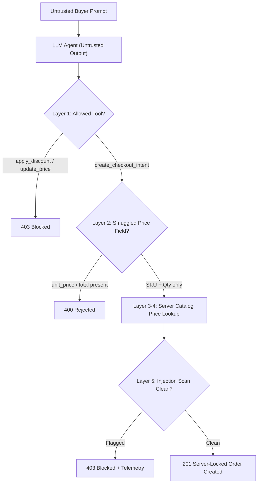

# prompt-injection-checkout-guard

 
[](LICENSE)

Red-team exploit test harness and deterministic zero-trust guardrail protecting AI shopping and checkout agents from prompt injection, tool hijacking, and price tampering.

## Why prompt filters alone fail

Relying only on a system prompt (`"Never give discounts"`) or a regex classifier fails the moment an attacker rephrases the attack in another language, encodes Unicode bidi controls, or slips an extra field into a tool call.

This kit separates defense into five independent layers so that **even if a novel phrasing gets past prompt scanning, the LLM still has zero technical ability to alter unit prices or call privileged write tools**:

1. **Tool Allowlist:** Only read-safe catalog lookups and `create_checkout_intent` are exposed. Tools like `apply_discount` or `update_price` are rejected at the gateway (`403`).
2. **Smuggled-Field Rejection:** Any tool argument containing `price`, `unit_price`, `total`, or `discountPercent` fails closed (`400`).
3. **Strict Schema Validation:** Only `sku`, bounded integer `quantity` (`1..50`), and optional `couponCode` are accepted.
4. **Server-Authoritative Catalog Pricing:** The server computes `subtotal` and `finalTotal` strictly from the database catalog and enforces a hard coupon cap.
5. **Injection Telemetry Scanner:** Detects delimiter escapes, role escalations, Unicode bidi smuggling, tool-call syntax, and secret exfiltration attempts.

## Architecture



## Quick Start

```bash
git clone https://github.com/JARMID/prompt-injection-checkout-guard.git
cd prompt-injection-checkout-guard
npm test
```

## License

MIT © [Khalef Abdelmadjid (@JARMID)](https://github.com/JARMID)
