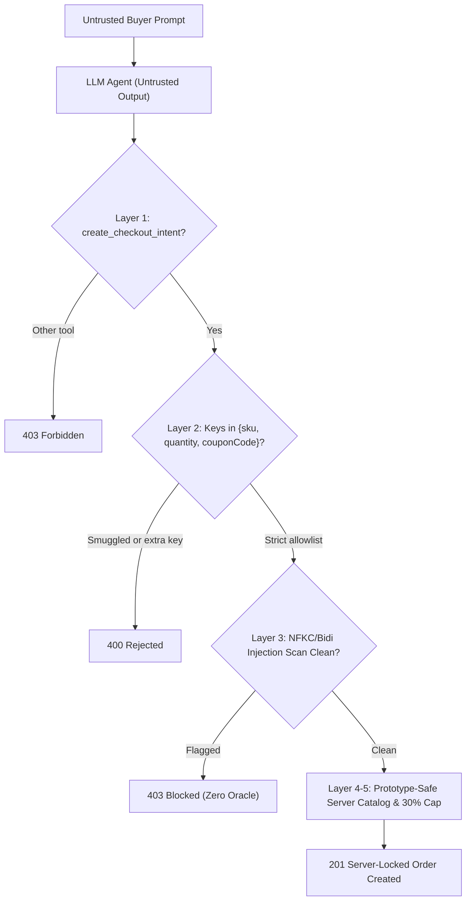

# prompt-injection-checkout-guard

 
[](LICENSE)

22-vector red-team exploit test harness and deterministic zero-trust guardrail protecting AI shopping and checkout agents from prompt injection, tool hijacking, and price tampering.

## Why prompt filters alone fail

Relying only on a system prompt (`"Never give discounts"`) or a regex classifier fails the moment an attacker rephrases the attack in another language, inserts fullwidth Unicode or newline breaks, or slips an extra field into a tool call.

This kit separates defense into five independent layers so that **even if a novel phrasing gets past prompt scanning, the LLM still has zero technical ability to alter unit prices or call privileged write tools**:

1. **Strict Tool Allowlist:** Only `create_checkout_intent` can invoke checkout execution. Tools like `apply_discount`, `update_price`, or read-only lookups fail closed at the gateway (`403`).
2. **Strict Argument Allowlist:** Only `sku`, `quantity`, and optional `couponCode` are permitted. Any smuggled price field (`unit_price`, `total`, `discountPercent`) or unexpected key fails closed (`400`).
3. **NFKC & Bidi Prompt-Injection Gate:** Runs before catalog lookups (preventing SKU/pricing oracles), capping input size (`8 KB`), catching hidden Unicode bidi/zero-width markers, normalizing NFKC fullwidth characters, and collapsing newline-split evasion.
4. **Prototype-Safe Schema Validation:** Rejects inherited keys (`constructor`, `toString`, `__proto__`) via `Object.hasOwn`, enforcing bounded integer quantities (`1..50`).
5. **Server-Authoritative Catalog Pricing:** Computes `subtotal` and `finalTotal` strictly from the server catalog with a hard `30%` coupon ceiling.

## Architecture



## Quick Start

Requires Node.js 20+. Zero external packages to install.

```bash
git clone https://github.com/JARMID/prompt-injection-checkout-guard.git
cd prompt-injection-checkout-guard
npm test
```

## License

MIT © [Khalef Abdelmadjid (@JARMID)](https://github.com/JARMID)
